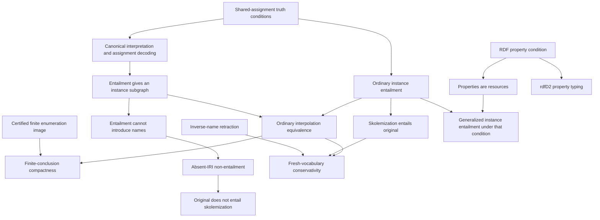

# Third increment: connected entailment proofs

23 October 2026. Landed Lean definitions and theorems; draft source mappings and English glosses await expert review. No F* lineage or Factoidal implementation modules are imported. This is the source-first task authorized for this experiment, not an implementation port.

The catalogue now maps **54 of 195 preliminary claim records, including partial mappings**, up from 42. This is not a completeness percentage: the inventory itself needs expert extraction review, unresolved source ranges remain, and no published package is refined by these proofs.

## The shared argument

The main addition is ordinary interpolation completeness. A canonical simple interpretation encodes exactly a premise graph's triples. Applying model-theoretic entailment to this interpretation provides an assignment for the conclusion; decoding that one shared assignment yields a term substitution whose image is a subgraph of the premise. The previously proved ordinary instance-entailment theorem supplies the converse.

The carrier is `ULift (Option (Term Iri Literal B))`. The extra `none` element ensures nonempty IR even if all term domains are empty, and cannot appear in a relation witness. This particular interpretation has IR = IP; that is a witness choice, not an added axiom about every simple interpretation. It follows the specification's Herbrand-style proof idea without requiring its carrier to contain only occurring names.

The last edge denotes reuse of the assignment-pullback construction supporting ordinary instance entailment, not use of that theorem's ordinary premise as a generalized premise.

## New source mappings and strengthened ones

| Claim | Formal result and scope |
|---|---|
| MT11-INTERPOLATION | Both directions for ordinary conclusions, including infinite graphs; the necessary direction also holds for generalized conclusions |
| MT11-SIMPLE-DECIDABILITY | Ground-conclusion entailment iff subset; executable finite search and the complexity claim remain unformalized |
| MT11-COMPACTNESS | A finite ordinary conclusion has a finite sufficient premise subgraph, even when the original premise is infinite |
| MT11-NAMES-VOCABULARIES | Names, term/triple contributions, graph vocabulary and the two names contributed by a literal |
| MT11-FRESH-IRI-NONENTAILMENT | An IRI absent from the premise cannot occur in an entailed graph; a stronger vocabulary inclusion theorem is proved |
| MT11-SKOLEMIZATION | Supplied fresh/injective map on occurring blanks; existing substitution yields a ground, lean instance |
| MT11-SKOLEM-ENTAILS-ORIGINAL | Ordinary skolemization entails its original, reusing substitution entailment |
| MT11-ORIGINAL-NOT-SKOLEM | A source with a blank does not entail its skolemization, reusing absent-IRI non-entailment |
| MT11-SKOLEM-FRESH-VOCABULARY-CONSERVATIVITY | Ordinary conclusions avoiding fresh names have exactly the same simple entailments before and after skolemization |
| MT11-SATISFACTION | Added named satisfiable/unsatisfiable predicates and connected them to the existing universal simple satisfiability theorem |
| MT11-VALID-TRANSFORMATION | Valid/invalid process relations, valid composition, subgraph-process validity and extension preservation |
| MT11-EXTENSION-MONOTONICITY | Existing entailment-preservation lemmas now explicitly map to this source requirement, with syntax-admissibility caveat |
| MT11-RDF-PROPERTY-TYPING | The first RDF condition and its consequence IP ⊆ IR |
| MT11-RULE-rdfD2 | Predicate typing follows from that condition through the existing EntailsUnder relation |

The existing MT11-INSTANCE-ENTAILMENT mapping also links the new conditional generalized theorem. Full RDF interpretation has not been defined: datatype recognition, mandatory datatypes, the other RDF condition and axiomatic triples remain outstanding.

## Important scope choices

**Literal names.** `datatype : Literal → Iri` is an explicit projection of the syntactic datatype IRI. A literal contributes both itself and that IRI. This matches the abstract interface in Semantics §4 and Concepts §3.3; it does not validate concrete lexical forms or prove that an external implementation supplies the correct projection. Freshness/avoidance includes these embedded datatype names.

**Skolem names.** The chosen map is injective only on blanks occurring in G, and fresh against G's vocabulary. Global freshness at creation remains an external naming obligation. No existence theorem assumes that an arbitrary abstract IRI domain supplies enough fresh names. Semantics §6 replaces all occurring blanks; the optional partial replacement described in Concepts is separate.

**Conservativity.** The proof works without finite graphs or disjoint blank identity domains. It applies an inverse-name map to substitution images and proves the required scoped commutation. It does not assume that arbitrary substitutions commute. The source's separate lifting equation `H = sk(H′)` remains unformalized: exact equality needs careful treatment of blank identities/capture.

**RDF versus simple semantics.** The first RDF condition forces property denotations to belong to IR because they occur as subjects of rdf:type pairs in typed IEXT. This supplies precisely the missing hypothesis for generalized predicate pullback. The simple interpretation type remains unchanged, and its existing generalized-predicate countermodel remains checked. No conditional theorem is silently relabelled as simple entailment.

**Lean graphs.** The unrestricted claim that a lean graph cannot entail a proper instance remains open. The source proof sketch needs a justification that its resulting subgraph is proper, rather than merely a proper instance. Finite occurring-blank support is a possible route; the infinite case needs further work. No counterexample or specification erratum is asserted.

## Review navigation and accountability

The viewer's “Connected claims” panel follows actual elaborated declaration dependencies. Each navigation edge includes a declaration path. Shared bindings are labelled separately. These connections explain reuse; they are not proof that the English claim mappings are accurate or that claims are equivalent. English glosses are supplied for all displayed declarations and marked as unreviewed explanatory prose.

The frozen registry now includes **21 formal files and 552 local declarations**, with an elaborated closure of **2,516 declarations**. The 114 new local declarations, including generated helpers, were explicitly inspected and enrolled under seven source/support groups. Existing declaration signatures did not change. No new foundation modules or logical axioms were added. Verification still rejects unregistered code rather than enrolling it automatically.

The AI close-reading subagent reread the archived source prose and reviewed the scopes against the new Lean files. Selectors only locate those already selected passages. The skolem non-entailment mapping resolves its context explicitly: the preceding paragraph supplies the premise that G contains blanks.

## Validation and next obligations

Local validation: full `lake build`, `tools/verify.py`, seven rejection checks, nine Python tests, and viewer generation with required English glosses. The Pages workflow additionally runs Chromium interaction checks before deployment, including a conservativity → interpolation navigation path, source/reading tabs, glosses, filters, dependencies, deep links and mobile layout. No proof placeholders or added axioms are used.

Next connected work: concrete literal/datatype interfaces, D-interpretations, the remaining RDF conditions and axioms, then the RDFS condition/rule chain. Ordinary interpolation is now proved; the generalized scope question, lean/proper-instance theorem, exact skolem lifting, finite decision procedure, dataset material and independent review remain open. W3C fixtures and published JS/WASM integration remain separate obligations.
